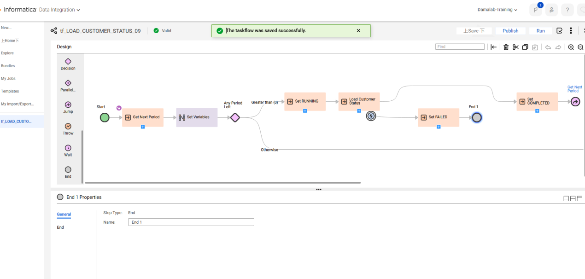
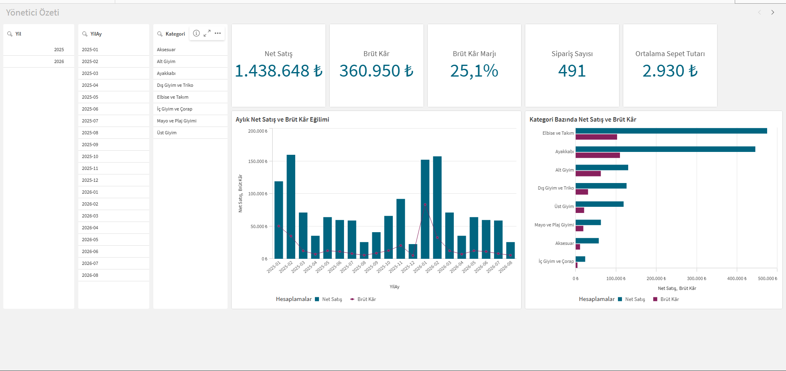

# KOMTAS Data Talent Bootcamp '26 – Bitirme Projeleri

17 Ağustos – 28 Eylül 2026 tarihleri arasında KOMTAS tarafından düzenlenen **Data Talent Bootcamp '26** programının iki bitirme projesi.

| Proje | Araç | Konu |
|---|---|---|
| [Müşteri Segmentasyonu](informatica-cdi/) | Informatica Cloud Data Integration (IDMC), Oracle | Müşterilerin aylık analitik statülerini hesaplayan, kontrol tablosu ile yönetilen uçtan uca ETL akışı |
| [Perakende Satış ve Kârlılık Analizi](qlik-sense/) | Qlik Sense Desktop | Satış ve kârlılık KPI'larını içeren yönetici dashboard'ları ve iş soruları analizi |

## 1. Informatica CDI – Müşteri Segmentasyonu

Oracle SH (Sales History) verisinden her ay sonu için 7.059 müşterinin her birine **Sadık, Yeniden Aktif, Aktif, Pasif veya Hareketsiz** statüsünü atayan bir akış. İşlenecek dönemler bir kontrol tablosundan okunur ve Taskflow ile ay ay işlenir. Sonuçlar, aynı mantığı doğrudan Oracle SQL ile hesaplayan bir referans sorguyla karşılaştırıldı ve her dönemde birebir eşleşti.



➡️ Detaylar: [informatica-cdi/README.md](informatica-cdi/)

## 2. Qlik Sense – Perakende Satış ve Kârlılık Analizi

Ocak 2025 – Ağustos 2026 satış verisiyle net satış, brüt kâr, kâr marjı, sipariş sayısı ve ortalama sepet tutarını izleyen 4 sayfalık bir Qlik Sense uygulaması. Analiz sırasında 2026 büyümesini tek başına açıklayan hatalı bir satış kaydı tespit edildi ve bulgulara yansıtıldı.



➡️ Detaylar: [qlik-sense/README.md](qlik-sense/)

## Klasör yapısı

```
├── informatica-cdi/
│   ├── README.md          # tasarım, akış, karşılaşılan sorunlar, doğrulama
│   ├── sql/               # referans ve doğrulama sorguları
│   └── images/            # IDMC ekran görüntüleri
└── qlik-sense/
    ├── README.md          # veri modeli, ölçüler, sayfalar, bulgular
    ├── Mehmet_Kaan_Akyazi_Qlik_Projesi.qvf
    ├── Mehmet_Kaan_Akyazi_Qlik_Dokumantasyon.pdf
    └── images/
```

---

**Mehmet Kaan Akyazı**
