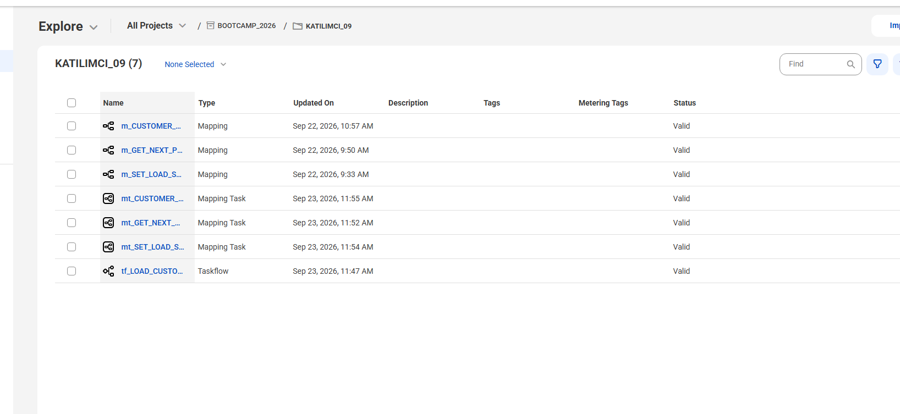
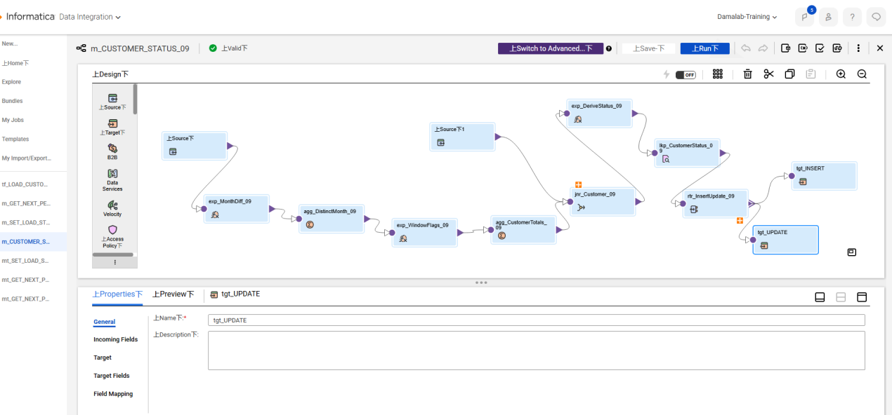
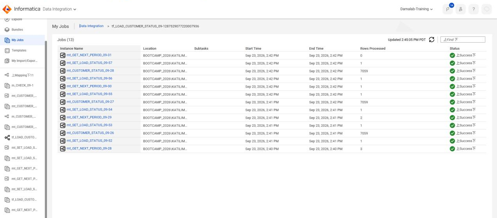
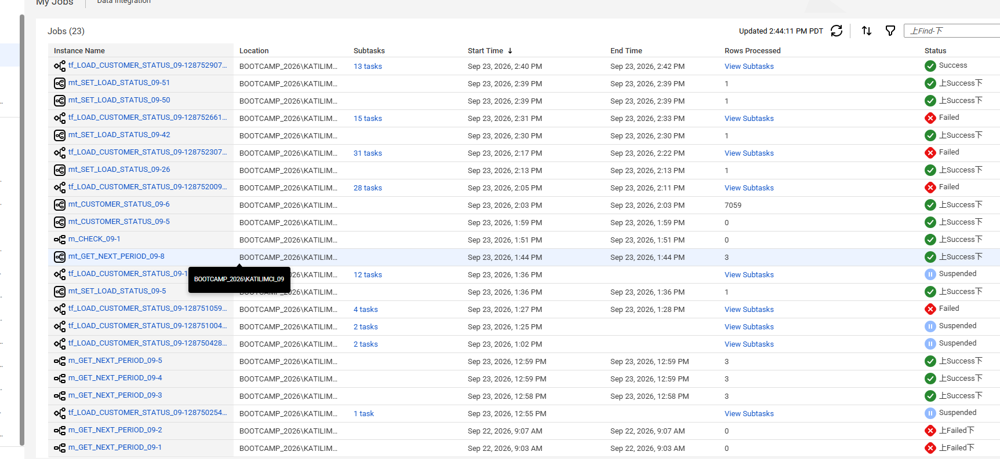
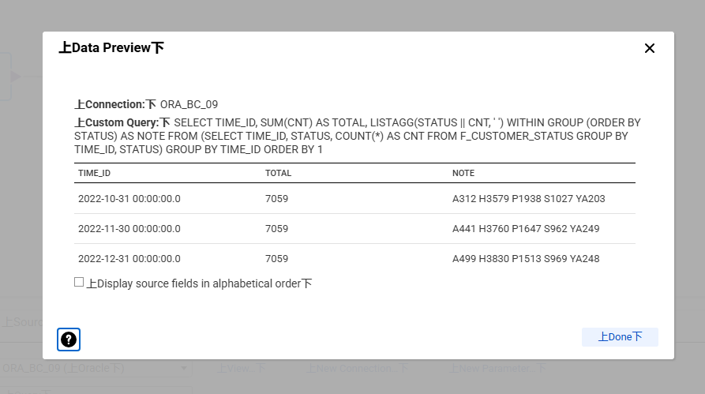
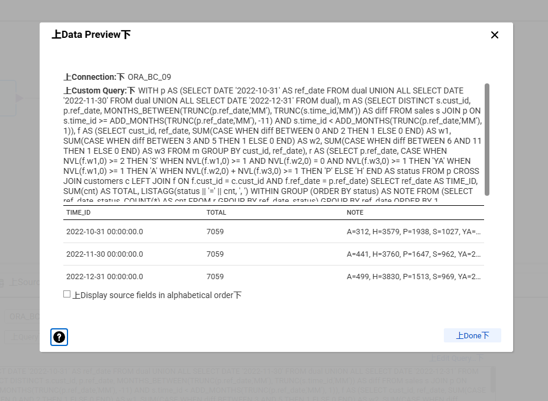
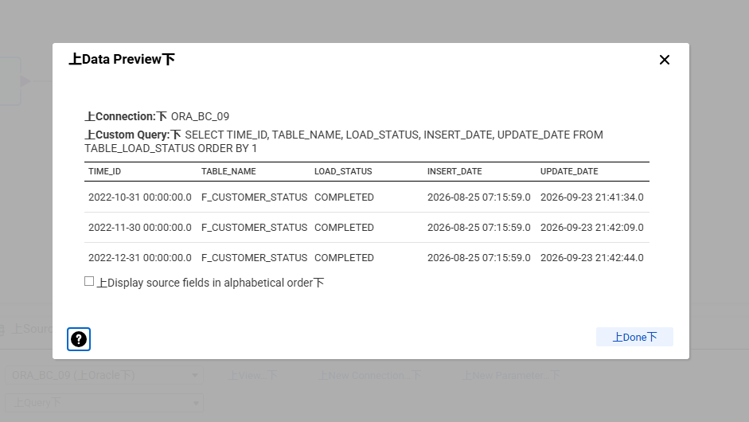
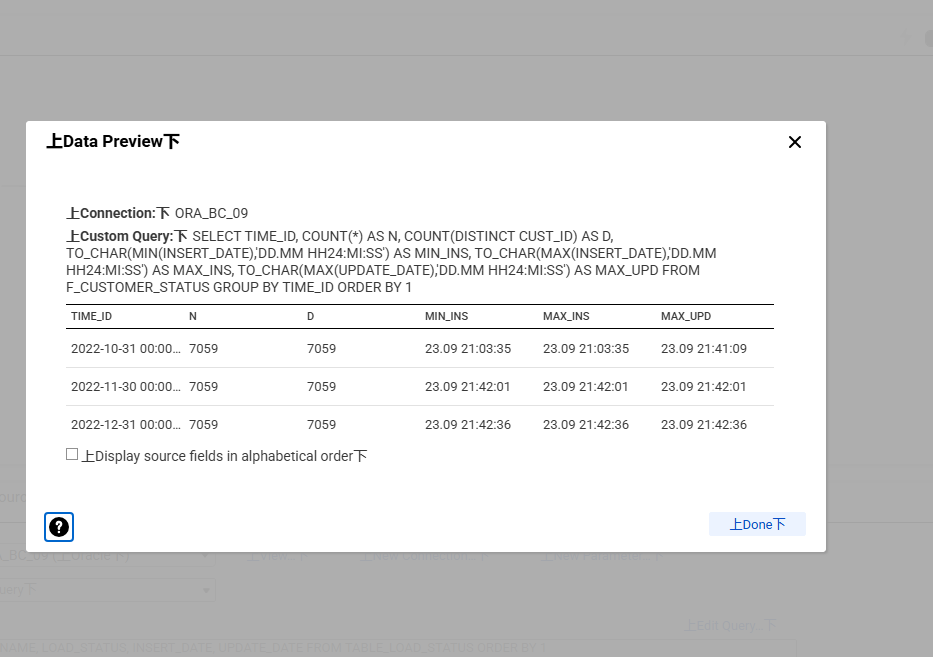
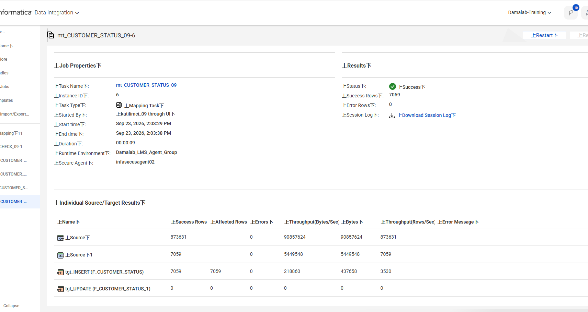

# Müşteri Segmentasyonu – Informatica Cloud Data Integration

Oracle SH (Sales History) şemasından türetilen satış verisiyle, müşterilerin **aylık analitik statülerini** hesaplayıp hedef tabloya yazan uçtan uca bir veri entegrasyonu akışı. Hesaplama ve yükleme akışının tamamı Informatica IDMC Cloud Data Integration üzerinde kuruldu; statü mantığı transformation'larla, ay ay ilerleyen yükleme döngüsü ise bir Taskflow ile yönetiliyor.

## Statü tanımları

Her müşteri, hesaplama yapılan ay sonundan geriye bakılarak tam olarak bir statü alır. Önce üç pencere tanımlanır:

| Pencere | Ay farkı | Karşılığı |
|---|---|---|
| W1 | 0 – 2 | Son 3 ay (hesaplanan ay dahil) |
| W2 | 3 – 5 | Ondan önceki 3 ay |
| W3 | 6 – 11 | Ondan da önceki 6 ay |

Statüler öncelik sırasıyla uygulanır:

| Kod | Statü | Koşul |
|---|---|---|
| S | Sadık | W1 içinde en az iki **farklı** ayda alışveriş |
| YA | Yeniden Aktif | W1'de alışveriş var, W2'de yok, W3'te var |
| A | Aktif | W1'de alışveriş var, yukarıdakilere girmiyor |
| P | Pasif | W1'de yok, W2 veya W3'te var |
| H | Hareketsiz | Son 12 ayda hiç alışveriş yok |

## Tablolar

- **SALES** (918.843 satır), **CUSTOMERS** (7.059 müşteri): kaynak
- **F_CUSTOMER_STATUS** (`TIME_ID`, `CUST_ID`, `STATUS`, `INSERT_DATE`, `UPDATE_DATE`): hedef
- **TABLE_LOAD_STATUS**: işlenecek dönemleri ve `READY → RUNNING → COMPLETED / FAILED` durumunu tutan kontrol tablosu
- **WRK_RUN_LOG**: yardımcı log tablosu

## Oluşturulan nesneler



| Nesne | Tür | Görev |
|---|---|---|
| `m_GET_NEXT_PERIOD_09` | Mapping | READY olan en küçük `TIME_ID`'yi ve kalan READY sayısını In-Out Parameter'lara (`MinTimeId` – Min, `ReadyCount` – Count) `SetMinVariable` / `SetCountVariable` ile yazar |
| `m_SET_LOAD_STATUS_09` | Mapping | Parametrik (`InPeriod`, `InStatus`); dönemin `LOAD_STATUS` ve `UPDATE_DATE` alanını günceller. Hedef işlemi Update, Update Columns: `TIME_ID`, `TABLE_NAME` |
| `m_CUSTOMER_STATUS_09` | Mapping | Statü hesabı ve hedefe Insert / Update |
| `mt_*` (3 adet) | Mapping Task | Mapping'leri Taskflow'dan çağıran görevler |
| `tf_LOAD_CUSTOMER_STATUS_09` | Taskflow | Döngü, durum yönetimi ve hata dalı |

## Statü hesabı: `m_CUSTOMER_STATUS_09`



| Adım | Transformation | Açıklama |
|---|---|---|
| 1 | Source `SALES` | Dönem sonuna kadar olan satışlar: `TIME_ID <= TO_DATE($InPeriod$, 'MM/DD/YYYY')` |
| 2 | `exp_MonthDiff_09` | Referans aya uzaklık. İki tarih de ayın başına indirgenip fark alınır: `DATE_DIFF(TRUNC(TO_DATE($InPeriod$,'MM/DD/YYYY'),'MM'), TRUNC(TIME_ID,'MM'), 'MM')`. Böylece ay sonu tarihlerinden kaynaklanan ondalık farklar ve pencere kayması oluşmaz |
| 3 | `agg_DistinctMonth_09` | `CUST_ID` + ay farkı bazında tekilleştirme. Aggregator DISTINCT saymadığı için önce müşteri × ay tekilleştirilir, aynı ay içindeki birden fazla alışveriş müşteriyi yanlışlıkla Sadık yapmaz |
| 4 | `exp_WindowFlags_09` | W1 / W2 / W3 bayrakları (0/1) |
| 5 | `agg_CustomerTotals_09` | Müşteri bazında bayrak toplamları |
| 6 | `jnr_Customer_09` | `CUSTOMERS` Master, satış özeti Detail, **Detail Outer Join**. Satışı olmayan Hareketsiz müşteriler de evrende kalır |
| 7 | `exp_DeriveStatus_09` | Statüler birbirini dışladığı için Router yerine tek bir iç içe `IIF` (aşağıda) |
| 8 | `lkp_CustomerStatus_09` + `rtr_InsertUpdate_09` | Hedefte `TIME_ID` + `CUST_ID` var mı? Yoksa **Insert**, varsa **Update** dalı |
| 9 | `tgt_INSERT` / `tgt_UPDATE` | Insert dalı `INSERT_DATE = UPDATE_DATE = SYSDATE`; Update dalı yalnızca `STATUS` ve `UPDATE_DATE`'i yazar, `INSERT_DATE` korunur |

```
IIF(IIF(ISNULL(d_v_TotalW1),0,d_v_TotalW1) >= 2, 'S',
IIF(IIF(ISNULL(d_v_TotalW1),0,d_v_TotalW1) >= 1
    AND IIF(ISNULL(d_v_TotalW2),0,d_v_TotalW2) = 0
    AND IIF(ISNULL(d_v_TotalW3),0,d_v_TotalW3) >= 1, 'YA',
IIF(IIF(ISNULL(d_v_TotalW1),0,d_v_TotalW1) >= 1, 'A',
IIF(IIF(ISNULL(d_v_TotalW2),0,d_v_TotalW2)
    + IIF(ISNULL(d_v_TotalW3),0,d_v_TotalW3) >= 1, 'P',
'H'))))
```

## Yükleme akışı: `tf_LOAD_CUSTOMER_STATUS_09`


```
Start
 -> Get Next Period          (m_GET_NEXT_PERIOD_09)
 -> Set Variables            (tPeriod, tRemaining)
 -> Any Period Left?         tRemaining > 0 ?
      Hayır -> End
      Evet  -> Set RUNNING           (m_SET_LOAD_STATUS_09)
            -> Load Customer Status  (m_CUSTOMER_STATUS_09)
                  hata -> Set FAILED -> End
            -> Set COMPLETED         (m_SET_LOAD_STATUS_09)
            -> Jump -> Get Next Period
```

- İşlenen dönem mapping'lere `tPeriod` değişkeniyle geçirilir; hiçbir yerde sabit yazılı değildir.
- **Hata yönetimi:** `Load Customer Status` adımında *Custom error handling* ile hata dalı tanımlandı. Mapping hata verirse dönem `FAILED` olarak işaretlenir ve akış sonsuz döngüye girmeden kontrollü sonlanır. Bu dal geliştirme sırasında gerçek bir hatayla (ORA-00904) sınandı.

Taskflow; 31.10.2022, 30.11.2022 ve 31.12.2022 dönemlerini sırayla işleyip 13 alt görevle başarıyla tamamlandı. `Get Next Period` adımının okuduğu READY sayısı her turda azaldı (3 → 2 → 1 → 0):





## Karşılaşılan sorunlar ve çözümler

| Sorun | Çözüm |
|---|---|
| Atanan Secure Agent grubu çalışmıyordu, Hosted Agent Oracle'a erişemiyordu (`ORA-12203`) | Oracle'a erişimi olan agent grubu kullanıldı |
| `WRT_8004 Writer initialization failed`: reject dosyası oluşturulamıyordu | Varsayılan Source/Target adları özel karakter içeriyordu; tüm hedefler ASCII adlarla (`tgt_…`) yeniden adlandırıldı |
| `MinTimeId` parametresi hiç güncellenmiyordu | `SetMinVariable` çağıran alan bir hedef kolona bağlı olmadığı için hesaplanmıyordu; alan hedefe bağlandı. Min için başlangıç değeri `12/31/2999` yapıldı |
| Döngü ilk dönemde takılıyor, READY sayısı azalmıyordu | In-Out Parameter değerleri döngü turları arasında taşınıyordu (Min ilk ayda kalıyor, Count birikiyordu). `Get Next Period` adımının girişinde her turda `MinTimeId` ve `ReadyCount` sıfırlandı |
| Source filtresinde `ORA-00904: "ADD_TO_DATE": invalid identifier` | Source filtresi doğrudan Oracle'a gönderildiği için Informatica fonksiyonu tanınmadı; filtre sadeleştirildi. 12 aydan eski satışlar hiçbir pencereye girmediği için sonuç değişmez |
| Hedeflere hiç satır yazılmıyordu | İki hedef de Router'ın `DEFAULT` portuna bağlıydı; Insert ve Update grupları kendi portlarına bağlandı |
| Parametre söz dizimi | In-Out parametreler `$$Ad`, Input parametreler `$Ad$`; taskflow'dan gelen değerler metin olarak yerleştiği için tarih ve statü değerleri tırnaklı geçirildi |

## Doğrulama

**Statü doğruluğu.** Aynı mantığı doğrudan Oracle SQL ile hesaplayan [referans sorgu](sql/referans_statu_sorgusu.sql) ile karşılaştırıldı; her dönemde ve her statüde sonuç birebir aynı:

| Dönem | S | YA | A | P | H | Toplam |
|---|---:|---:|---:|---:|---:|---:|
| 31.10.2022 | 1.027 | 203 | 312 | 1.938 | 3.579 | 7.059 |
| 30.11.2022 | 962 | 249 | 441 | 1.647 | 3.760 | 7.059 |
| 31.12.2022 | 969 | 248 | 499 | 1.513 | 3.830 | 7.059 |

| CDI sonucu (`F_CUSTOMER_STATUS`) | Referans SQL sonucu |
|---|---|
|  |  |

**Akış yönetimi.** Üç dönem de `READY → RUNNING → COMPLETED` geçişini tamamladı:



**Tekrar çalıştırılabilirlik.** 31.10.2022 dönemi geliştirme sırasında defalarca yeniden işlendi. Her dönemde satır sayısı = tekil müşteri sayısı = 7.059 (mükerrer kayıt yok); 31.10 için `INSERT_DATE` ilk yüklemedeki değerinde sabit kalırken `UPDATE_DATE` son çalıştırmaya ilerledi:



İlk yüklemede 7.059 satırın tamamı Insert dalından yazıldı:



Kullanılan doğrulama sorguları: [sql/dogrulama_sorgulari.sql](sql/dogrulama_sorgulari.sql)
