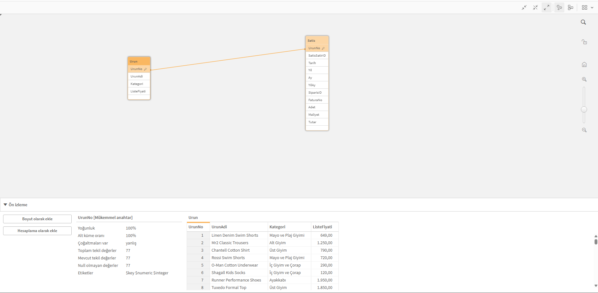
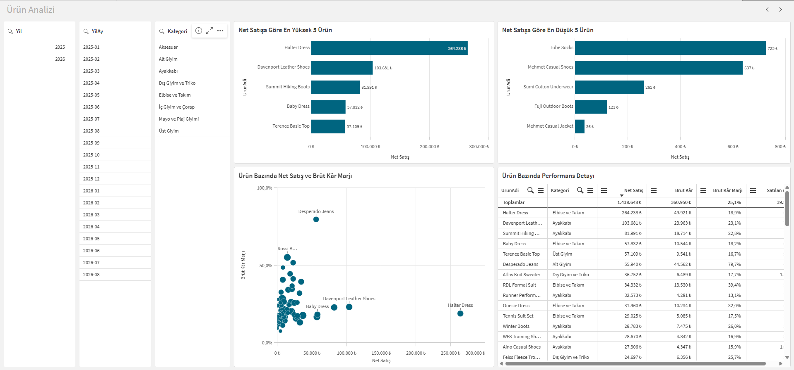
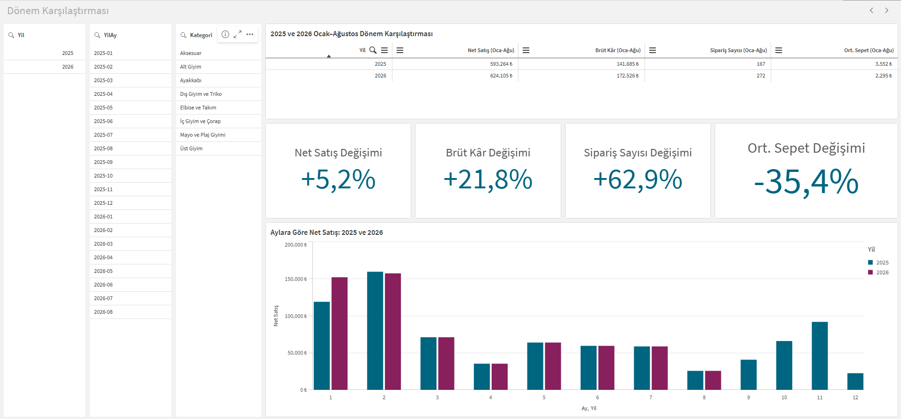
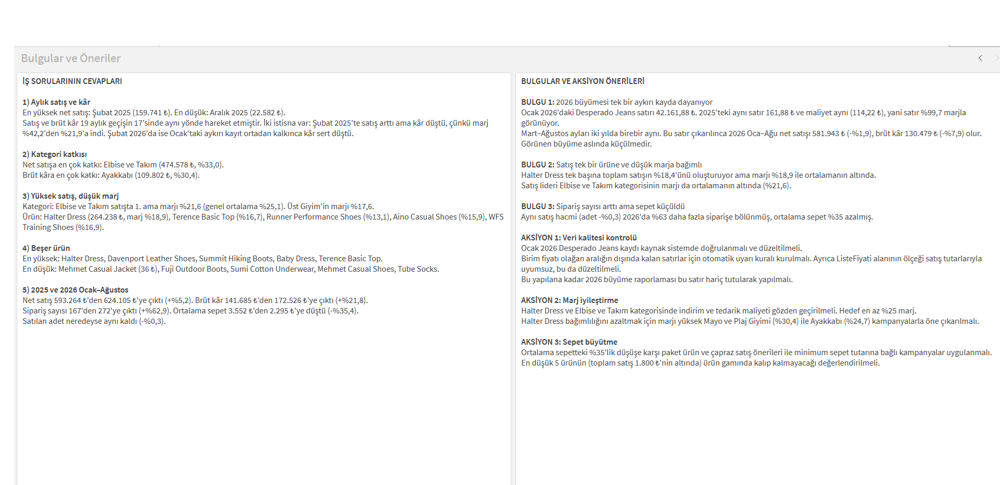

# Perakende Satış ve Kârlılık Analizi – Qlik Sense

Kurgusal bir perakende şirketinin **1 Ocak 2025 – 31 Ağustos 2026** satış sonuçlarını analiz eden bir Qlik Sense Desktop uygulaması. Amaç; satışın ve brüt kârın zaman içindeki değişimini, kategori ve ürün performansını, sipariş hacmini ve ortalama sepet tutarını tek bir uygulamada izlemek ve yönetime somut bulgular sunmak.

- Uygulama: [`Mehmet_Kaan_Akyazi_Qlik_Projesi.qvf`](Mehmet_Kaan_Akyazi_Qlik_Projesi.qvf) (Qlik Sense Desktop ile açılır)
- Dokümantasyon: [`Mehmet_Kaan_Akyazi_Qlik_Dokumantasyon.pdf`](Mehmet_Kaan_Akyazi_Qlik_Dokumantasyon.pdf)

## Veri modeli

İki tablo `UrunNo` alanı üzerinden ilişkilendirildi; sentetik anahtar veya döngü yok.

| Tablo | Satır | Alanlar |
|---|---:|---|
| Satis | 1.639 | SatisSatirID, Tarih, Yil, Ay, YilAy, SiparisID, FaturaNo, UrunNo, Adet, Maliyet, Tutar |
| Urun | 77 | UrunNo, UrunAdi, Kategori, ListeFiyati |

Veri kontrolünde dikkat edilen noktalar:
- `FaturaNo` farklı tarihlerde tekrar ettiği için (287 tekil fatura, 491 tekil sipariş) sipariş sayısı `SiparisID` ile hesaplandı.
- `ListeFiyati` alanı satış tutarlarıyla aynı ölçekte olmadığı için KPI hesaplarında kullanılmadı.

## Ölçüler

| Ölçü | İfade |
|---|---|
| Net satış | `Sum(Tutar)` |
| Toplam maliyet | `Sum(Maliyet)` |
| Brüt kâr | `Sum(Tutar) - Sum(Maliyet)` |
| Brüt kâr marjı | `(Sum(Tutar) - Sum(Maliyet)) / Sum(Tutar)` |
| Sipariş sayısı | `Count(DISTINCT SiparisID)` |
| Ortalama sepet tutarı | `Sum(Tutar) / Count(DISTINCT SiparisID)` |
| Satılan adet | `Sum(Adet)` |

Tüm dönem: **1.438.648 ₺** net satış, **360.950 ₺** brüt kâr, **%25,1** marj, **491** sipariş, **2.930 ₺** ortalama sepet.

## Sayfalar

**1. Yönetici Özeti:** KPI'lar, Yıl / YilAy / Kategori filtreleri, aylık satış-kâr eğilimi, kategori karşılaştırması

**2. Ürün Analizi:** en yüksek ve en düşük 5 ürün, ürün bazında satış-marj dağılımı, detay tablo

**3. Dönem Karşılaştırması:** 2025 ve 2026 Ocak–Ağustos dönemlerinin karşılaştırması

**4. Bulgular ve Öneriler:** iş sorularının cevapları, bulgular ve aksiyon önerileri

## İş soruları

1. **Aylık satış ve kâr:** En yüksek net satış Şubat 2025 (159.741 ₺), en düşük Aralık 2025 (22.582 ₺). Satış ve brüt kâr 19 aylık geçişin 17'sinde aynı yönde hareket etti.
2. **Kategori katkısı:** Net satışa en çok Elbise ve Takım (%33,0), brüt kâra en çok Ayakkabı (%30,4) katkı sağladı.
3. **Yüksek satış, düşük marj:** Elbise ve Takım satışta 1. ama marjı %21,6 (genel ortalama %25,1). Ürün bazında Halter Dress, Terence Basic Top, Runner Performance Shoes, Aino Casual Shoes ve WFS Training Shoes öne çıkıyor.
4. **Beşer ürün:** En yüksek Halter Dress, Davenport Leather Shoes, Summit Hiking Boots, Baby Dress, Terence Basic Top. En düşük Mehmet Casual Jacket, Fuji Outdoor Boots, Sumi Cotton Underwear, Mehmet Casual Shoes, Tube Socks.
5. **2025 ve 2026 Ocak–Ağustos:**

| | 2025 | 2026 | Değişim |
|---|---:|---:|---:|
| Net satış | 593.264 ₺ | 624.105 ₺ | +%5,2 |
| Brüt kâr | 141.685 ₺ | 172.526 ₺ | +%21,8 |
| Sipariş sayısı | 167 | 272 | +%62,9 |
| Ortalama sepet | 3.552 ₺ | 2.295 ₺ | -%35,4 |

## Bulgular

- **2026 büyümesi tek bir hatalı kayda dayanıyor.** Ocak 2026'daki Desperado Jeans satırı 42.161,88 ₺; aynı satır 2025'te 161,88 ₺ ve maliyeti değişmemiş, yani satır %99,7 marjla görünüyor. Bu satır hariç tutulduğunda 2026 Ocak–Ağustos net satış **-%1,9**, brüt kâr **-%7,9**; görünen büyüme aslında küçülme.
- **Satış tek bir ürüne ve düşük marja bağımlı.** Halter Dress toplam satışın %18,4'ünü oluşturuyor, marjı ise %18,9 ile ortalamanın altında.
- **Sipariş sayısı arttı, sepet küçüldü.** Satılan adet neredeyse aynı kalırken (-%0,3) sipariş sayısı %63 arttı, ortalama sepet %35 azaldı.

## Aksiyon önerileri

1. **Veri kalitesi kontrolü:** Ocak 2026 Desperado Jeans kaydı kaynak sistemde doğrulanmalı; birim fiyatı olağan aralığın dışında kalan satırlar için otomatik uyarı kuralı kurulmalı.
2. **Marj iyileştirme:** Halter Dress ve Elbise ve Takım kategorisinde indirim ve tedarik maliyeti gözden geçirilmeli; marjı yüksek Mayo ve Plaj Giyimi (%30,4) ile Ayakkabı kampanyalarla öne çıkarılmalı.
3. **Sepet büyütme:** Paket ürün, çapraz satış önerileri ve minimum sepet tutarına bağlı kampanyalar uygulanmalı.
